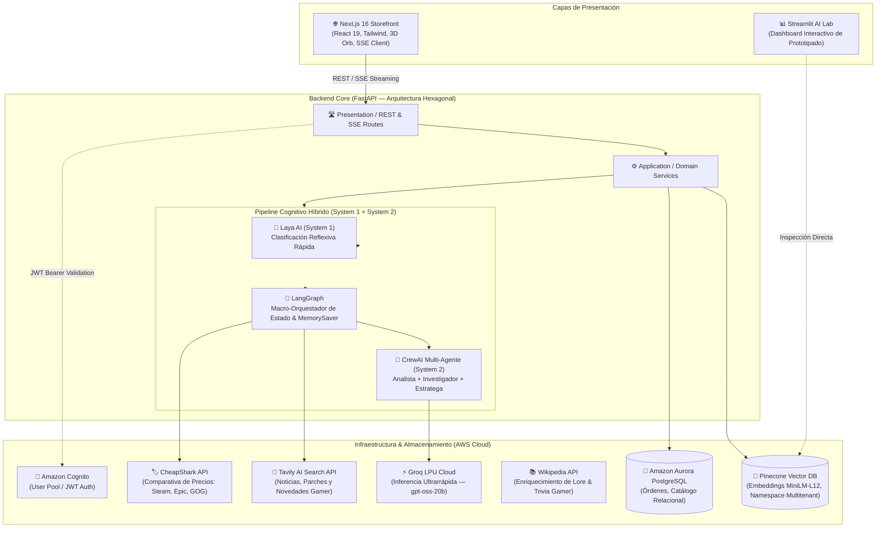

# 🎮 Nexus Digital Store — Enterprise Multi-Agent E-Commerce Platform

> Plataforma enterprise de comercio electrónico gamer de última generación impulsada por una **arquitectura híbrida de Inteligencia Artificial (System 1 + System 2)**, orquestación multi-agente determinista, búsqueda vectorial en la nube y arquitectura hexagonal orientada al dominio.

---

## 🏛️ 1. Arquitectura de Alto Nivel

Nexus combina lo mejor del desarrollo web moderno, arquitectura limpia y pipelines avanzados de IA generativa y multi-agente:



---

## 🧩 2. Estructura del Monorepo

```plaintext
nexus/
├── docker-compose.yml              # Orquestación completa multi-contenedor
├── .gitignore                      # Reglas globales de exclusión y seguridad
├── test_ai.py                      # Script interactivo de validación E2E para la IA
│
├── nexus-digital-store/
│   ├── nexus-backend/              # API Principal (FastAPI, Python 3.11, UV)
│   │   ├── src/nexus_backend/
│   │   │   ├── ai_assistant/       # Módulo IA: LangGraph, CrewAI, Laya, Pinecone
│   │   │   │   ├── domain/         # Entidades puras y puertos (Hexagonal)
│   │   │   │   ├── application/    # Casos de uso, servicios, grafos y cadenas LCEL
│   │   │   │   ├── infrastructure/ # Adaptadores (Groq, Pinecone, HF, Wikipedia)
│   │   │   │   └── presentation/   # Endpoints HTTP y Server-Sent Events (SSE)
│   │   │   ├── auth/               # Autenticación JWT y usuarios
│   │   │   ├── catalog/            # Gestión de videojuegos, géneros y stock
│   │   │   ├── orders/             # Procesamiento y ciclo de vida de órdenes
│   │   │   └── config.py           # Configuración centralizada vía Pydantic Settings
│   │   ├── tests/                  # 97 pruebas unitarias e integración (Pytest)
│   │   └── Dockerfile              # Contenedor optimizado de producción
│   │
│   └── nexus-frontend/             # Storefront (Next.js 16, React 19, TypeScript)
│       ├── src/
│       │   ├── app/                # App Router de Next.js
│       │   ├── components/         # UI Components (Shadcn UI, Lucide, 3D Canvas)
│       │   └── hooks/              # Consumo reactivo de eventos SSE del asistente
│       └── Dockerfile              # Multi-stage build para Next.js Standalone
│
└── nexus-ai/                       # Entorno de Experimentación y Observabilidad
    ├── app.py                      # App visual en Streamlit con inspección de prompts
    └── Dockerfile              
```

---

## 🤖 3. Arquitectura del Asistente IA (NexusBot)

### Pipeline Dual (System 1 + System 2)
1. **System 1 (Detección Reflexiva Rápida)**:  
   Implementado con **Laya AI**. Clasifica en microsegundos la intención del usuario (`greeting`, `recommendation`, `stock_price`), determinando si la consulta amerita costosas búsquedas externas o si se resuelve de manera inmediata.
2. **System 2 (Razonamiento Multi-Agente & RAG)**:  
   - **Vector DB**: Búsqueda semántica de catálogo en **Pinecone** (índice `nexus-catalog`, dimensión 384, espacio multitenant `nexus_chile`).
   - **Trivia Gamer**: Inyección de contexto histórico y curiosidades vía **Wikipedia API**.
   - **Noticias & Actualidad Gamer**: Búsqueda de parches, anuncios y lanzamientos vía **Tavily AI Search API**.
   - **Comparador de Precios Externos**: Análisis en tiempo real de ofertas en tiendas de PC (Steam, Epic Games Store, GOG, Humble Store, etc.) vía **CheapShark API**, con conversión a pesos chilenos ($ CLP) y dictamen explícito de ahorro frente a Nexus Digital Store.
   - **CrewAI**: Tres agentes autónomos colaboran en cadena:
     - *Catalog & Inventory Analyst*: Valida stock y disponibilidad real.
     - *Gaming Culture Researcher*: Conecta el lore del título con los intereses del usuario.
     - *Senior Sales Strategist*: Consolida los argumentos de venta éticos y transparentes.
   - **LangGraph & MemorySaver**: Macro-orquestador de 4 nodos que preserva el hilo conversacional multi-turno mediante checkpoints (`thread_id`), permitiendo al usuario repreguntar sin reenviar el historial.
   - **Streaming en Tiempo Real**: Protocolo **SSE (`text/event-stream`)** que despacha tarjetas de producto interactivas (`type: products`) seguidas de tokens generados en streaming (`type: token`).

---

## 🚀 4. Puesta en Marcha Rápida (Local & Docker)

### Requisitos Previos
- **Docker & Docker Compose** (v2+)
- **Python 3.11+** con gestor [`uv`](https://github.com/astral-sh/uv)
- **Node.js 20+** y `pnpm`

### Opción A: Despliegue con Docker Compose (Recomendada)
Para levantar todos los servicios integrados:

```bash
# 1. Clonar el repositorio y ubicarse en la raíz
cd c:\nexus

# 2. Configurar variables de entorno (revisar claves en .env)
# 3. Construir y levantar contenedores
docker compose up --build -d
```

| Servicio | URL Local | Descripción |
| :--- | :--- | :--- |
| **Storefront Web** | [http://localhost:3000](http://localhost:3000) | Tienda gamer con asistente 3D y streaming reactivo |
| **API Backend** | [http://localhost:8000](http://localhost:8000) | FastAPI con documentación Swagger en `/docs` |
| **AI Dashboard** | [http://localhost:8501](http://localhost:8501) | Consola interactiva de Streamlit para el laboratorio IA |

---

### Opción B: Ejecución Manual para Desarrollo

#### 1. Backend (`nexus-backend`)
```bash
cd nexus-digital-store/nexus-backend

# Sincronizar dependencias con uv
uv sync

# Ejecutar pruebas automatizadas
uv run python -m pytest

# Iniciar servidor de desarrollo
uv run uvicorn nexus_backend.main:app --reload --port 8000
```

#### 2. Frontend (`nexus-frontend`)
```bash
cd nexus-digital-store/nexus-frontend

pnpm install
pnpm dev
```

#### 3. Probar la IA en Terminal
Para verificar la recuperación semántica, el razonamiento y la memoria conversacional multi-turno:
```bash
uv run python test_ai.py
```

---

## 🛡️ 5. Calidad de Software, Testing y Seguridad

- **Pruebas Automatizadas**: 97 tests unitarios y de integración (`pytest`, `pytest-asyncio`, `httpx-asgi`) con **100% de tasa de aprobación** y ejecución en menos de 10 segundos.
- **Arquitectura Hexagonal**: Aislamiento estricto entre el dominio, los puertos y los adaptadores de infraestructura.
- **Gestión de Secretos**: Exclusión total de credenciales sensibles mediante `.gitignore` estructurado para evitar fugas de claves en repositorios remotos.
- **Observabilidad**: Integración nativa con **LangSmith** para trazabilidad de cadenas y grafos de ejecución de agentes.
